# AI Photography Archive

https://kejinphotoarchive.com
写真のアップロードから EXIF / GPS の整理、AI による画像理解、自然言語でのセレクト、Portfolio の公開までを一つの流れにまとめた、個人向けの写真アーカイブです。

本プロジェクトでは、写真を「保存する」だけでなく、撮影情報と視覚的な特徴を検索可能なデータとして蓄積し、言葉から作品を組み立てられる体験を実装しました。フロントエンド、API、データモデル、AI 連携、公開機能、運用時のセキュリティまでを一貫して設計しています。

## 主な機能

- JPEG / PNG のアップロード、サムネイル生成、最大 20 MB のファイル検証
- EXIF、GPS、カメラ、レンズ、焦点距離、露出情報の抽出
- DeepSeek による画像説明と視覚タグの非同期生成
- 自然言語から撮影条件やテーマを解析する AI Create
- 写真の並び順、表紙、タイトルを編集できる Portfolio
- CSS 3D による Story、PDF 出力、無効化可能な公開リンク
- 撮影傾向をローカル集計する Shooting Insights
- 日本語 / 中国語 UI、Session 認証、ユーザー単位のデータ分離

## Library

Library はアプリケーションの入口です。複数写真のアップロード状況、検索、お気に入り、AI 解析状態を同じ画面で確認できます。空データ、検索結果なし、アップロード失敗、AI 解析失敗などの状態も個別に設計しています。

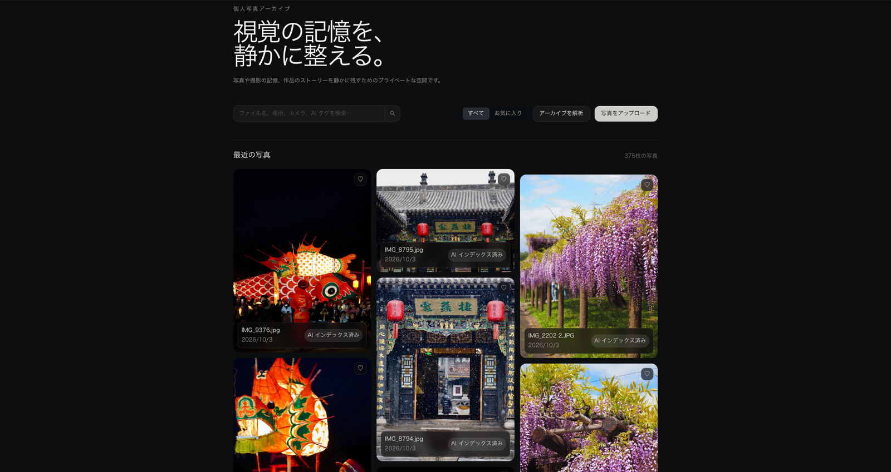

*Library — 写真の検索、アップロード、AI 解析状態を一つの画面で管理*

## Photo Detail とメタデータ

アップロード時に画像の向きを補正し、EXIF / GPS を抽出します。詳細画面では、撮影日時、カメラ、レンズ、焦点距離、絞り、シャッター速度、ISO、位置情報、AI 説明、タグを確認できます。GPS がない写真には、AI Create で利用する場所名を手動で追加できます。

<table>
  <tr>
    <td width="72%">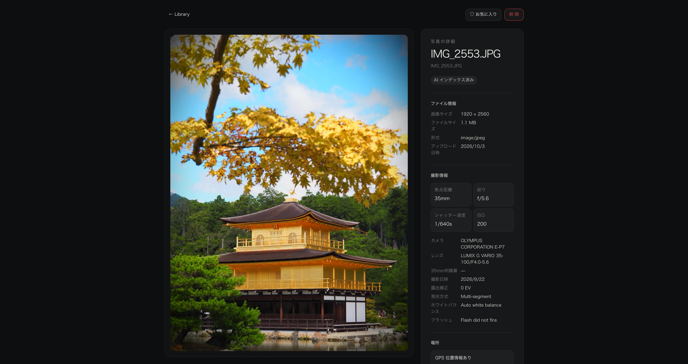</td>
    <td width="28%">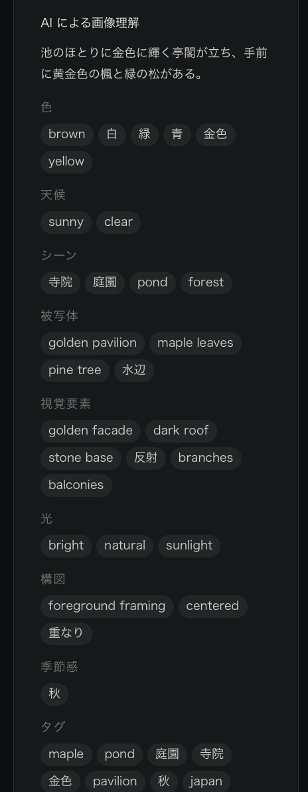</td>
  </tr>
  <tr>
    <td align="center"><em>写真詳細と構造化された EXIF 情報</em></td>
    <td align="center"><em>AI による説明と視覚タグ</em></td>
  </tr>
</table>

## AI Create

AI Create は、自然言語を Year、Season、Location、ISO、焦点距離、構図、色、被写体、除外条件などの検索意図に変換し、保存済みデータから最大 20 枚の候補を返します。

明確な撮影条件はローカルルールでも解析し、DeepSeek が一時的に利用できない場合でも技術条件による検索を可能にしています。選定時に AI へ送るのは検索文と既存タグの語彙であり、元画像を再送信しません。候補はユーザー自身が削除・並べ替え・表紙指定してから Portfolio として保存します。

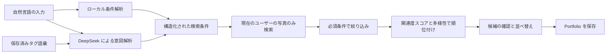

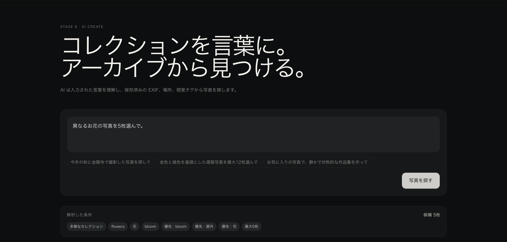

*自然言語で条件を入力し、検索意図を解析*

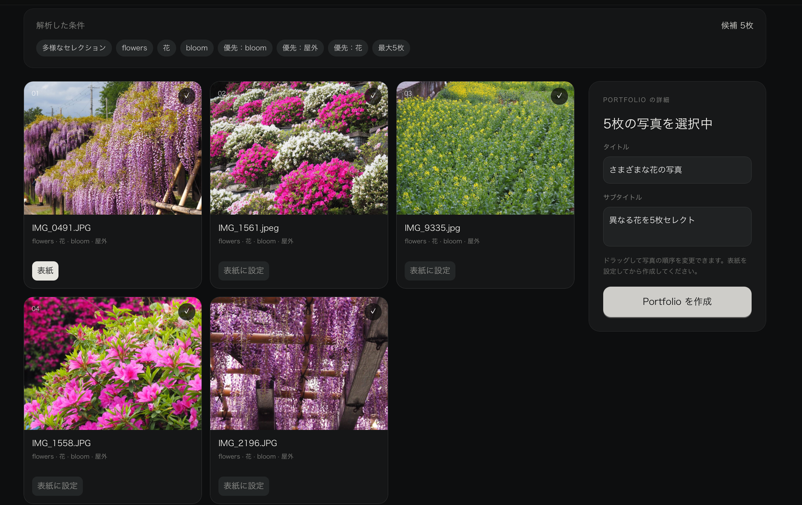

*条件に合う候補を確認し、Portfolio に使用する写真を編集*

## Portfolio

Portfolio には 1〜20 枚の写真を保存でき、タイトル、サブタイトル、表紙、表示順を編集できます。元の Library 写真とは独立して作品の並びを管理し、PDF 出力や公開リンクの発行にも対応します。公開は停止でき、停止後は以前の共有 URL が無効になります。

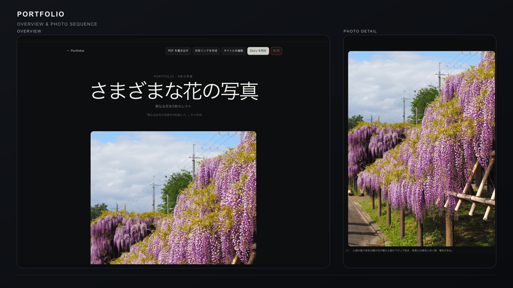

*Portfolio — タイトルと操作メニューを示す Overview、作品番号と説明を含む Photo Detail*

## 3D Story

Story は WebGL を使わず、CSS 3D で写真を円柱状に配置します。3 秒ごとの自動再生、クリック、キーボード、タッチスワイプ、再生停止に対応し、横・縦・正方形の写真を切り取らずに表示します。`prefers-reduced-motion` が有効な環境では、3D 移動を使わないフェード表示に切り替えます。

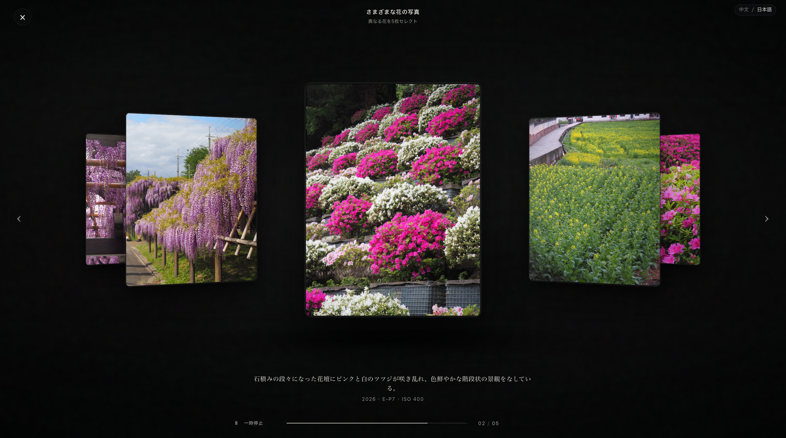

*Story — 前後の写真を立体的に配置した再生画面*

## Shooting Insights

Shooting Insights は、現在のユーザーの写真データだけを集計します。直近 12 か月の撮影リズム、よく使う焦点距離・機材・場所、EXIF / GPS / AI タグのカバー率を表示します。集計と短い観察文は保存済みデータからローカルで生成するため、ページを開いても追加の AI 呼び出しは発生しません。

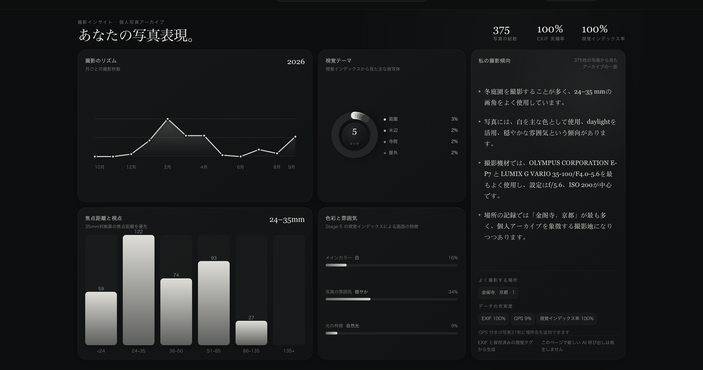

*Shooting Insights — 保存済みメタデータから撮影傾向を可視化*

## 日本語と中国語の UI

主要画面、ナビゲーション、操作メッセージ、空状態、エラー表示は日本語と中国語を切り替えられます。フロントエンドには辞書キーの整合性を確認するスクリプトがあり、バックエンドの業務メッセージにもロケール別リソースを使用しています。

<table>
  <tr>
    <td width="50%">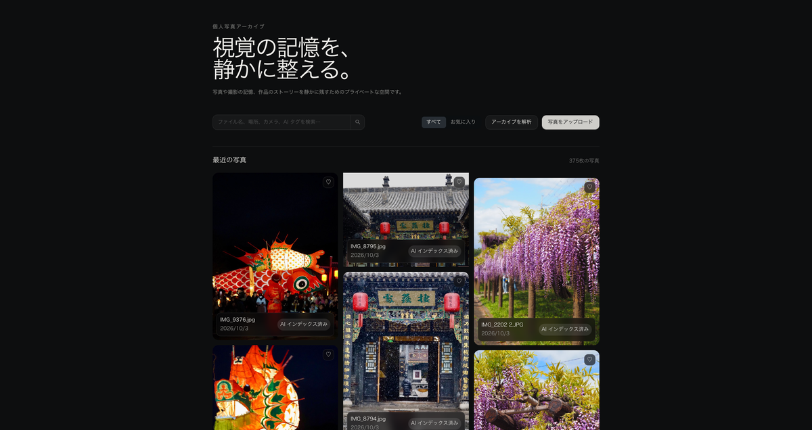</td>
    <td width="50%">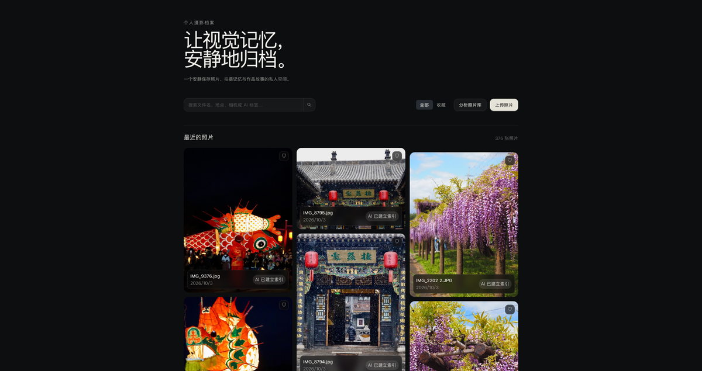</td>
  </tr>
  <tr>
    <td align="center"><em>日本語</em></td>
    <td align="center"><em>中文</em></td>
  </tr>
</table>

## システム構成

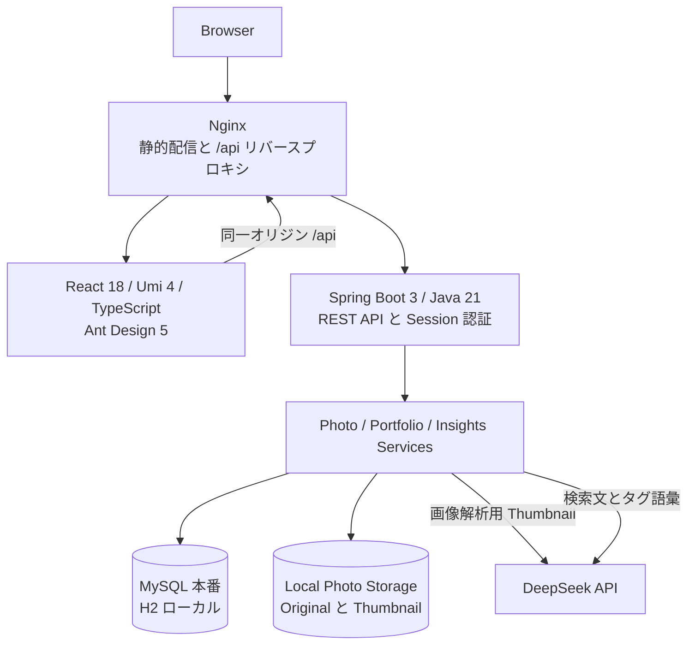

### 写真アップロードと解析

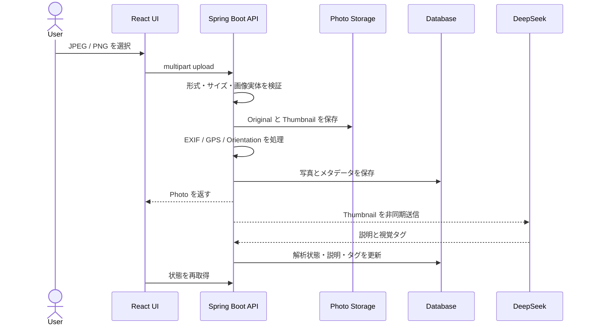

## 技術スタック

| 領域 | 採用技術 | 実装上の役割 |
| --- | --- | --- |
| Frontend | React 18, Umi 4, TypeScript, Ant Design 5 | ルーティング、認証ガード、アップロード、レスポンシブ UI、i18n |
| Backend | Java 21, Spring Boot 3.3, MyBatis-Plus | REST API、Session 認証、所有権検証、業務ロジック |
| Database | MySQL, H2, Flyway | 本番データ、ローカル開発、バージョン管理されたスキーマ移行 |
| Media | metadata-extractor, PDFBox, ZXing | EXIF / GPS、Portfolio PDF、共有用 QR コード |
| AI | DeepSeek API | 画像説明・タグ生成、自然言語の検索意図解析 |
| Delivery | Maven, pnpm, Nginx | テスト、ビルド、静的配信、API リバースプロキシ |

## データ境界とセキュリティ

- すべての写真、Portfolio、Insights の読み書きを現在の Session ユーザーに限定しています。
- ユーザー API はパスワード、電話番号、メールアドレスを含まない `UserVO` を返します。
- パスワードは平文ではなく BCrypt で保存します。
- AI 画像解析では Thumbnail を送信します。AI Create では元画像を再送信せず、検索文と保存済みタグ語彙だけを送信します。
- 公開 Portfolio は推測しにくい Token で参照し、所有者が公開停止すると既存リンクを無効化します。
- API Key、データベース認証情報、保存先は環境変数またはローカル専用設定から注入します。

公開用スクリーンショットを準備する際は、アカウント名、メールアドレス、個人写真、正確な GPS、住所、共有 Token、Cookie、API Key を必ず確認してください。画像は自分が公開権限を持つ写真、または利用許諾を得た素材だけを使用してください。

## テストと品質確認

- Backend: 写真アップロード、無効ファイル、20 MB 制限、EXIF / GPS、ユーザー分離、Portfolio 権限、Insights、AI Create の条件解析を JUnit で検証
- Frontend: TypeScript 型チェック、辞書キー整合性チェック、production build
- UI: 1280 × 720 と 390 × 844、1 / 2 / 3 / 5 枚の Story、横・縦混在、連続操作、`prefers-reduced-motion` を確認
- 障害時: AI 未設定・失敗、EXIF / GPS なし、空データ、画像読込失敗でもアーカイブの基本機能を継続

既知の制約と公開前の確認項目は [Known Issues](docs/known-issues.md) と [Security Checklist](docs/SecurityChecklist.md) にまとめています。

## ローカル実行

### 必要な環境

- Java 21
- Maven 3.9 以降
- Node.js 24
- pnpm 12

ローカル開発では H2 を使用するため、MySQL は必須ではありません。AI 機能を利用する場合のみ `DEEPSEEK_API_KEY` が必要です。

### 1. AI 設定

```bash
cd backend
./configure-deepseek-local.sh
```

このスクリプトはリポジトリに commit されないルートの `.env.local` を使用します。AI を使わずに基本機能だけを確認する場合は、この手順を省略できます。

### 2. Backend

```bash
cd backend
./run-local.sh
```

### 3. Frontend

```bash
cd frontend
pnpm install --frozen-lockfile
pnpm dev
```

開発中はフロントエンドの URL にアクセスします。Umi が同一オリジンの `/api/...` を `http://localhost:8080` に転送します。写真は既定で `backend/data/storage/` に保存されます。

## Build

```bash
cd backend
mvn clean test package

cd ../frontend
pnpm install --frozen-lockfile
pnpm typecheck
pnpm test:i18n
pnpm build
```

本番環境では `application-prod.yml` を使用し、`DB_URL`、`DB_USERNAME`、`DB_PASSWORD`、`PHOTO_STORAGE_ROOT` を設定します。Nginx、公開、ロールバックの手順は [Deployment Guide](deploy/README.md) を参照してください。

## ドキュメント

- [API Contract](docs/api-contract.md) — 現在の API、リクエスト、レスポンス、権限
- [Acceptance Record](docs/acceptance.md) — 自動テストとブラウザ確認の記録
- [Stage 4](docs/ai-photography-archive-stage-4.md) — EXIF、GPS、Orientation
- [Stage 6–7](docs/ai-photography-archive-stage-6-7.md) — AI Create、Portfolio、Story
- [Stage 8](docs/ai-photography-archive-stage-8.md) — Shooting Insights
- [Stage 9](docs/ai-photography-archive-stage-9.md) — 最終 UI と境界状態

## Marketing & User Feedback

公開後は、中国語圏の写真愛好家に向けた告知と、アンケートによるフィードバック収集に取り組んでいます。利用者の声をもとに改善を重ね、将来的には継続して価値を提供できる有料サービスとして、安定した運営を目指しています。

### WeChatでのサービス紹介

WeChat公式アカウントで、開発背景・主要機能・利用方法を紹介する記事を公開しました。写真関連のグループでは、記事とともに、本サービスで作成した写真の公開ページへの共有リンクを掲載し、実際の作例を通じて利用イメージを伝えました。

### ユーザーアンケートの設計と実施

サービスへの関心や改善点を把握するため、紹介記事を読んだ方や実際に利用した方を対象に、約2〜3分で回答できるアンケートを作成しました。現在も回答を受け付けています。

主な質問項目は以下のとおりです。

- **撮影習慣と写真の管理規模**：普段の撮影頻度、長期保存・整理したい写真の枚数
- **関心のある機能**：撮影情報の自動取得、AIによる画像理解、自然言語検索、自動セレクト、作品集の作成、Shooting Insights
- **サービスの魅力度と利用意向**：実際に使ってみたいか、自分のニーズに合っているか
- **追加してほしい機能**：今後の開発に期待する機能
- **使いにくさや分かりにくさ**：実際に利用して気になった操作や表示
- **その他の意見・改善提案**：自由記述によるフィードバック

選択式の質問に加え、自由記述欄を設けることで、機能への要望や利用時の困りごと、懸念点も把握できるようにしています。

### フィードバックをもとにした改善と今後の展開

アンケートで寄せられた意見を整理し、追加機能の優先順位や、画面・操作の改善を検討していきます。利用時の不便や不安を減らし、写真の整理や活用に継続して役立つサービスへと改善を重ねる方針です。

将来的には、機能や使いやすさに加え、サービスの信頼性と運用面も整え、継続的かつ安定的に提供できる有料サービスへの発展を目指しています。有料化にあたっては、今回の調査とは別に、料金や有料機能の範囲、支払い意向についても確認していく予定です。

### 公開記事とアンケート

以下は、実際に公開した紹介記事とアンケートの一部です。いずれも中国語で作成しています。

<table>
  <tr>
    <td width="50%" valign="top" align="center">
      <strong>WeChatでのサービス紹介</strong><br><br>
      <a href="docs/images/wechat-launch-article.png">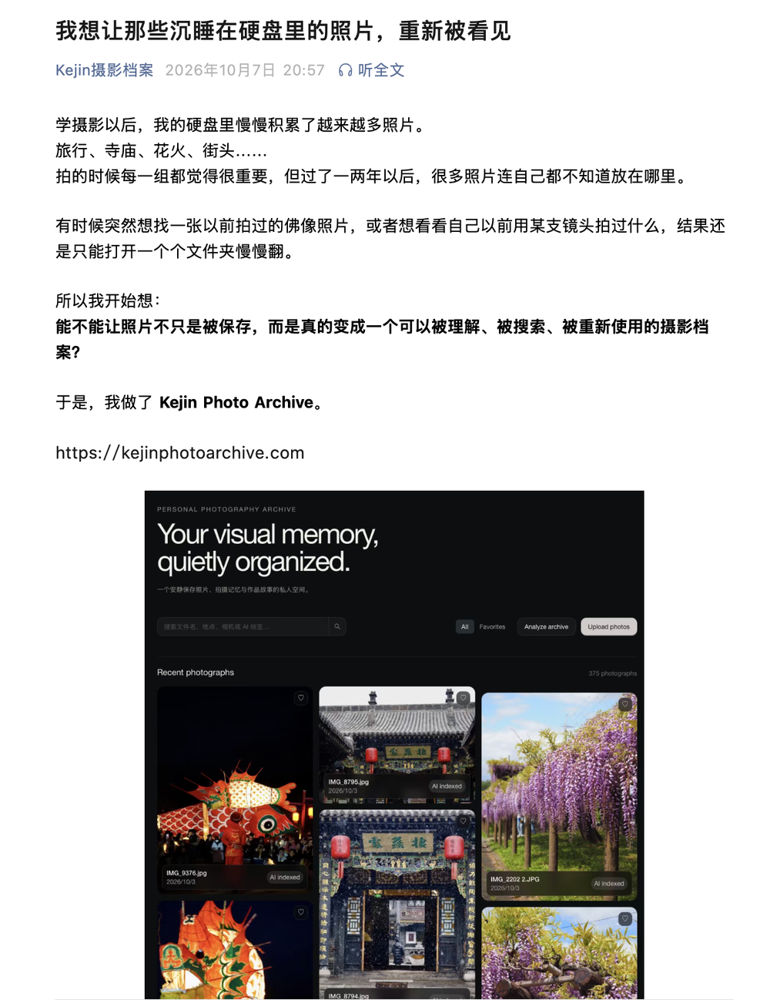</a><br>
      <sub>開発背景・主要機能・利用方法を紹介した公開記事（中国語）</sub>
    </td>
    <td width="50%" valign="top" align="center">
      <strong>ユーザーアンケート</strong><br><br>
      <a href="docs/images/early-survey-design.png">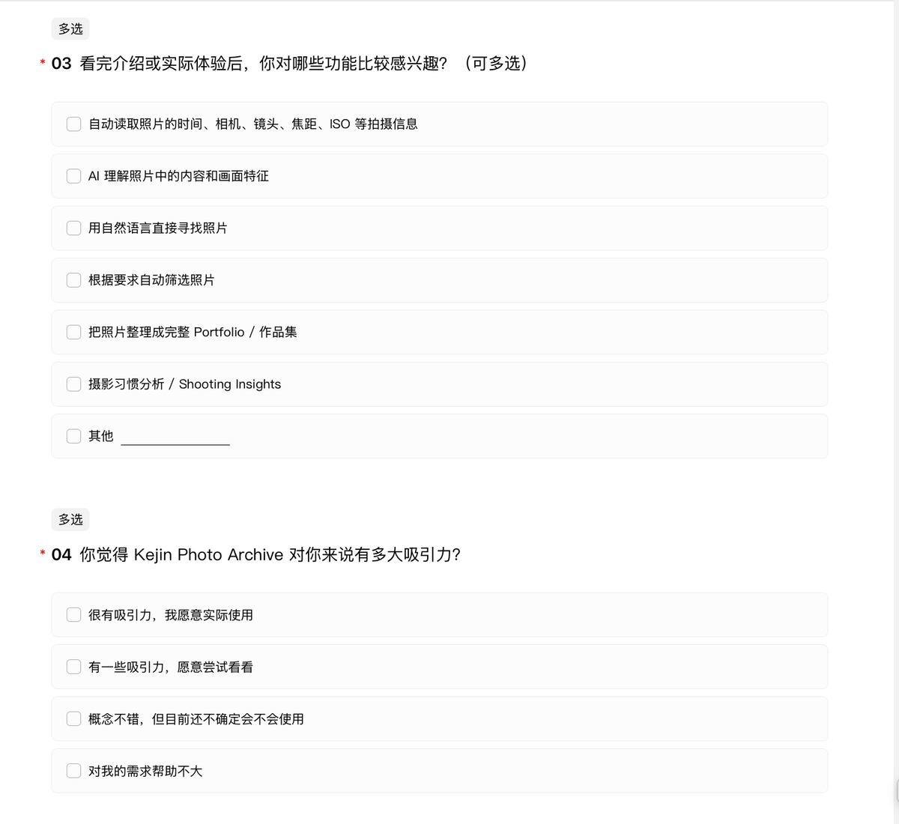</a><br>
      <sub>関心のある機能や利用意向などを尋ねるアンケートの一部（中国語）</sub>
    </td>
  </tr>
</table>

[アンケートを見る（中国語）](https://wj.qq.com/s2/28104609/vmi7/)
