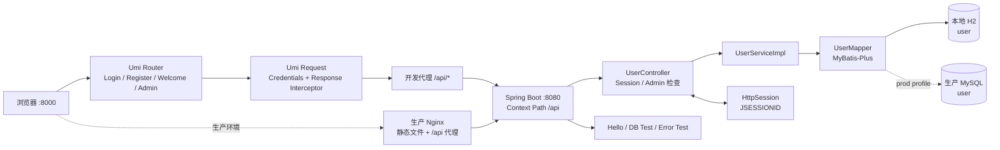
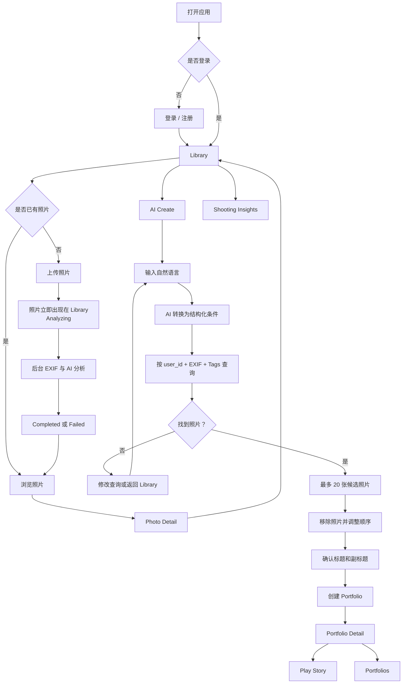

# AI Photography Archive - Stage 0-1 开发基线

> 文档状态：已确认  
> 更新日期：2026-10-02  
> 适用范围：Stage 0 现有项目盘点、Stage 1 页面流程与基础 UI 方向  
> 说明：本文档是进入 Stage 2 前的产品与技术基线。后续如需改变已确认范围，应同步更新本文档。

---

## 1. 项目定位

AI Photography Archive 是一个面向个人摄影作品的 AI 归档与展示系统。

系统复用现有 User Center 的账户、登录、权限和管理员基础，在其上增加：

- 个人摄影图库；
- 照片上传、缩略图和详情；
- EXIF 与 GPS 信息；
- AI 图片标签和描述；
- 自然语言照片筛选；
- Portfolio 作品集；
- Story 沉浸式展示；
- Shooting Insights 摄影习惯洞察。

核心产品原则：

1. AI 负责理解用户想找什么照片，不负责生成复杂布局。
2. Spring Boot 负责用户隔离、可靠筛选和业务规则。
3. 前端使用固定、可控的页面和 Story 模板展示内容。
4. 照片上传后立即可见，AI 分析异步执行并明确展示状态。
5. V1 聚焦一条完整、可演示的核心链路，不持续增加外围功能。

---

## 2. 已确认的 V1 范围

### 2.1 V1 包含

- 注册、登录、注销和登录态恢复；
- 普通用户与管理员权限；
- 上传照片、生成缩略图、查看详情、删除和收藏；
- 提取相机、镜头、焦段、光圈、快门、ISO、时间和 GPS；
- GPS 地点解析；
- AI 场景、季节、主体、颜色、标签和描述；
- AI 分析状态：Analyzing、Completed、Failed；
- 用自然语言生成结构化筛选条件；
- 使用 EXIF 和 AI Tags 从当前用户图库中筛选最多 20 张照片；
- 用户移除候选照片并调整顺序；
- 生成 Portfolio 标题和副标题；
- Portfolio Detail 管理与预览；
- Story 全屏播放；
- Shooting Insights 摄影习惯统计；
- Admin 用户管理基础。

### 2.2 V1 明确不做

- 独立 Albums 功能；
- Gallery 展示模式；
- 分享链接和社交分享；
- 下载或保存作品集到本地；
- 人脸识别和人物身份命名；
- 视频导出；
- AI 生成音乐；
- Vector Search；
- RAG；
- 自动摄影评分；
- 多种 Portfolio 模板；
- 复杂 Portfolio 编辑器。

### 2.3 关于 Gallery、Story 和 Portfolio 的最终决定

- `Library` 保存并展示用户的全部照片。
- `Portfolios` 保存用户已经创建的摄影作品集。
- V1 不单独实现 Albums。
- V1 取消 Gallery 作为正式展示模式。
- 每个 Portfolio 提供一个普通的 `Portfolio Detail` 页面，用于查看封面、标题、照片缩略图、顺序和管理操作。
- `Story` 是 Portfolio 唯一的正式展示模式。

---

# Stage 0 - 现有项目基础盘点

## 3. 当前项目结构

```text
user-center/
├── frontend/                   React 18 + Umi 4 + Ant Design
│   ├── config/                 路由与开发代理
│   ├── src/
│   │   ├── layouts/            全局布局与导航
│   │   ├── pages/              登录、注册、欢迎页、Admin
│   │   ├── services/           用户 API
│   │   ├── app.ts              初始用户状态与请求拦截
│   │   └── access.ts           前端权限判断
│   └── package.json
├── backend/                    Spring Boot API
│   └── src/main/
│       ├── java/com/example/usercenter/
│       │   ├── controller/
│       │   ├── service/
│       │   ├── mapper/
│       │   ├── model/
│       │   ├── config/
│       │   ├── common/
│       │   └── exception/
│       └── resources/
├── sql/create_table.sql        MySQL user 表结构
├── data/                       当前运行实例使用的 H2 数据
├── deploy/                     Nginx 与部署说明
└── docs/                       项目文档
```

## 4. React 前端现状

### 4.1 技术栈

- React 18；
- Umi 4 Simple App；
- Ant Design 5；
- TypeScript；
- pnpm；
- Umi request、initial-state、model 和 access 插件。

### 4.2 当前路由

| 路由 | 页面 | 权限 | 后续处理 |
| --- | --- | --- | --- |
| `/user/login` | 登录 | 公开 | 保留功能，统一新 UI |
| `/user/register` | 注册 | 公开 | 保留功能；旧编号字段已移除 |
| `/` | Welcome | 当前未限制登录 | 后续进入或重定向到 Library |
| `/admin/user` | 用户管理 | `canAdmin` | 保留并扩展 |
| `*` | 404 | 公开 | 保留并统一新 UI |

`src/pages/index.tsx` 和 `src/pages/docs.tsx` 当前没有被路由引用，属于示例或遗留页面。

### 4.3 当前 API 调用方式

前端使用 Umi `request`，用户 API 集中在 `frontend/src/services/user.ts`：

- `POST /api/user/register`
- `POST /api/user/login`
- `GET /api/user/current`
- `POST /api/user/logout`
- `GET /api/user/search`
- `POST /api/user/delete`

全局请求行为：

- `withCredentials: true`，携带 Session Cookie；
- 应用启动时调用 `/api/user/current` 恢复当前用户；
- 响应体 `code !== 0` 时，由前端响应拦截器转换为错误；
- 开发环境将 `/api/` 原样代理到 `http://localhost:8080`。

## 5. Spring Boot 后端现状

### 5.1 技术栈

- Java 21；
- Spring Boot 3.3.5；
- Spring MVC；
- Jakarta Validation；
- MyBatis-Plus 3.5.7；
- BCrypt；
- H2 本地开发；
- MySQL 生产环境。

### 5.2 当前后端分层

```text
controller/
├── UserController
├── HelloController
├── DatabaseTestController
└── TestController

service/
├── UserService
└── impl/UserServiceImpl

mapper/
└── UserMapper extends BaseMapper<User>

model/
├── entity/User
├── dto/user/UserLoginRequest
├── dto/user/UserRegisterRequest
└── vo/UserVO
```

当前没有 Spring Data Repository，数据库访问采用 MyBatis-Plus Mapper 与 ServiceImpl。

### 5.3 当前接口

业务接口：

- 注册；
- 登录；
- 获取当前用户；
- 注销；
- 管理员搜索用户；
- 管理员逻辑删除用户。

诊断接口：

- `GET /api/hello`
- `GET /api/db/test`
- `GET /api/test/error`

诊断接口可以用于本地开发，但生产环境不应无保护开放测试错误接口。

## 6. 数据库现状

### 6.1 当前环境差异

- 默认开发环境实际使用文件型 H2，而不是 MySQL。
- 启用 `prod` profile 后，通过环境变量连接 MySQL。
- 仓库只能确认 MySQL 建表定义，不能确认外部生产 MySQL 的实时数据。

### 6.2 当前业务表

当前只有 `user` 表：

| 字段 | 说明 |
| --- | --- |
| `id` | 自增主键 |
| `username` | 用户显示名称，可空 |
| `user_account` | 登录账号，唯一 |
| `avatar_url` | 头像地址 |
| `gender` | 性别 |
| `user_password` | BCrypt 密码摘要 |
| `phone` | 手机号 |
| `email` | 邮箱 |
| `user_status` | 用户状态，默认 0 |
| `user_role` | 0 普通用户，1 管理员 |
| `create_time` | 创建时间 |
| `update_time` | 更新时间 |
| `is_delete` | MyBatis-Plus 逻辑删除字段 |

### 6.3 本地数据库检查结果

- 当前运行实例使用项目根目录下的 `data/user-center.mv.db`；
- 当前运行数据库只有 `user` 表；
- 当前运行数据库有 1 条未删除普通用户记录，没有管理员；
- `backend/data/user-center.mv.db` 还存在另一份旧数据库，其中有 2 条普通用户记录；
- 两份数据库并存的原因是 H2 使用相对路径，从不同工作目录启动后端会连接不同文件。

## 7. 登录、注册与权限现状

### 7.1 当前实现

1. 注册时校验账号和密码确认。
2. 账号不允许重复。
3. 密码使用 BCrypt 保存。
4. 登录成功后调用 `changeSessionId()`。
5. 登录用户以 `UserVO` 形式写入 HttpSession。
6. 浏览器使用 `JSESSIONID` Cookie 保持登录态。
7. `UserVO` 不返回密码、手机号和邮箱。
8. 前端通过 `userRole === 1` 判断管理员入口。
9. 后端管理员接口再次检查 Session 中的管理员角色。

### 7.2 当前鉴权特点

- 当前使用手写 HttpSession 鉴权；
- 没有完整的 Spring Security 登录体系；
- 没有统一的登录用户解析器或鉴权拦截器；
- 普通首页当前没有 `isLogin` 路由限制；
- 新增摄影接口后，后端必须统一解析当前用户，并强制执行 `user_id` 数据隔离。

## 8. Admin 页面现状

当前 Admin 用户管理支持：

- 自动加载用户；
- 按 `username` 模糊搜索；
- 重置搜索；
- 显示 ID、用户名、账号、角色和状态；
- 删除前二次确认；
- MyBatis-Plus 逻辑删除；
- 前端分页。

当前限制：

- 后端没有真正分页；
- 只能按 `username` 搜索；
- 注册流程没有设置 `username`；
- 没有修改角色、冻结、恢复和审计功能；
- 当前运行数据库没有管理员账号。

## 9. 启动方式与端口

### 9.1 本地开发

```bash
cd backend
mvn spring-boot:run
```

- 后端端口：`8080`
- Context path：`/api`

```bash
cd frontend
pnpm install --frozen-lockfile
pnpm dev
```

- 前端端口：`8000`
- `/api/` 代理到 `http://localhost:8080`

### 9.2 生产部署

- Nginx 提供前端静态资源；
- Nginx 将 `/api/` 原样转发到 Spring Boot 8080；
- Spring Boot 使用 `prod` profile 连接 MySQL；
- Session Cookie 应在 HTTPS 下使用 `Secure=true`。

## 10. 当前架构图



## 11. 可以直接复用的部分

### 11.1 直接保留

- React、Umi、Ant Design 和 TypeScript 基础；
- Spring Boot 与 MyBatis-Plus 分层结构；
- `user` 表和 User Entity；
- 注册、登录、当前用户和注销接口；
- BCrypt 密码处理；
- Session ID 更换；
- UserVO 敏感字段隔离；
- BaseResponse 和前端响应拦截器；
- `/api` 同源代理方案；
- Admin 用户列表、搜索和逻辑删除基础；
- Nginx 静态资源与接口代理结构；
- 全局异常处理和 DTO Validation。

### 11.2 保留但需要强化

- HttpSession 登录体系需要统一的当前用户解析方式；
- 前端 initial-state 和 access 需要覆盖全部摄影页面；
- Admin 后续可增加必要的统计信息；
- 数据库需要引入 Flyway 或 Liquibase；
- 全局 Layout 需要替换为 Photography Archive 导航与视觉系统。

## 12. Stage 0 发现的主要风险

1. 本地 H2 与目标 MySQL 环境不一致。
2. 存在两份 H2 数据库文件，可能导致数据混乱。
3. 缺少统一登录鉴权层。
4. 登录 Session 中缓存的角色、状态和删除状态不会实时更新。
5. `userStatus` 当前不参与登录判断。
6. 当前运行数据库没有管理员初始化方案。
7. 业务错误统一返回 HTTP 200，只在响应体中区分业务码。
8. 没有 Flyway/Liquibase 数据库迁移机制。
9. 没有项目级自动化测试。
10. 尚未建立照片上传安全与文件一致性方案。
11. Session 是单机内存状态，服务重启后登录失效。
12. Admin 搜索没有服务端分页。

以上问题在 Stage 0 已完成识别和定界，但尚未修改代码。Stage 2 及后续开发需要按优先级处理。

---

# Stage 1 - 页面、流程与基础 UI

## 13. 登录后的产品导航

```text
Photography Archive

Library | AI Create | Portfolios | Insights
                                      Profile | Admin
```

说明：

- `Insights` 是导航中的简写，页面标题使用 `Shooting Insights`；
- `Admin` 只对管理员显示；
- `/` 登录后进入或重定向到 `/library`；
- 未登录访问摄影页面时跳转登录，并记录原目标地址。

## 14. 页面与路由

### 14.1 核心页面

| 页面 | 路由 | 主要职责 |
| --- | --- | --- |
| Library | `/library` | 上传、浏览、筛选和管理全部照片 |
| Photo Detail | `/photos/:photoId` | 查看大图、EXIF、GPS、地点和 AI 结果 |
| AI Create | `/ai-create` | 自然语言筛选、候选确认和创建作品集 |
| Portfolios | `/portfolios` | 查看已经创建的作品集 |
| Portfolio Detail | `/portfolios/:id` | 管理作品集照片、顺序和基本信息 |
| Story | `/portfolios/:id/story` | 沉浸式全屏播放作品集 |
| Shooting Insights | `/insights` | 查看摄影习惯统计 |

### 14.2 辅助页面

| 页面 | 路由 | 处理方式 |
| --- | --- | --- |
| Profile | `/profile` | 新增用户资料页 |
| Login | `/user/login` | 保留现有功能，统一新 UI |
| Register | `/user/register` | 保留现有功能，确认旧字段去留 |
| Admin | `/admin/user` | 保留并统一新 UI |
| 404 | `*` | 保留并统一新 UI |

## 15. 页面定义

### 15.1 Library

目标：让用户快速看到自己的全部照片，并完成上传、查看详情、收藏和删除。

主要内容：

- 大标题和简短说明；
- Upload Photos；
- 搜索框；
- All / Favorites 筛选；
- 简单排序；
- Masonry 照片网格；
- 收藏状态；
- AI 分析状态；
- 上传进度。

主要跳转：

- 点击照片进入 Photo Detail；
- 点击 AI Create 进入自然语言筛选；
- 没有照片时引导上传。

### 15.2 Photo Detail

目标：集中查看照片本身、摄影参数和 AI 理解结果。

主要内容：

- 大图；
- 相机、镜头、焦段、光圈、快门和 ISO；
- 拍摄时间；
- GPS 与地点；
- AI 标签与描述；
- AI 分析状态。

主要操作：

- 返回 Library；
- 收藏或取消收藏；
- 删除照片并二次确认；
- AI 分析失败时重新分析。

权限规则：只能查看当前用户自己的照片。

### 15.3 AI Create

AI Create 在一个页面中完成三个阶段：

1. 输入自然语言；
2. 确认候选照片；
3. 确认作品集标题和副标题。

主要规则：

- AI 将自然语言转换为 Year、Season、Location、Tags、Limit 等结构化条件；
- Spring Boot 使用当前用户的 EXIF 和 AI Tags 查询；
- 返回不超过 20 张照片；
- 用户可以移除照片；
- 用户可以调整顺序；
- 标题和副标题根据查询条件生成；
- 不再次把全部候选照片发送给 AI；
- 没有匹配结果时允许修改查询或返回 Library。

### 15.4 Portfolios

目标：查看已经创建的摄影作品集。

每个 Portfolio 显示：

- 封面；
- 标题；
- 副标题；
- 照片数量；
- 创建时间。

主要操作：

- 进入 Portfolio Detail；
- 直接 Play Story；
- 跳转 AI Create；
- 删除 Portfolio，但不删除原照片。

### 15.5 Portfolio Detail

目标：提供管理和预览，不作为正式 Gallery 展示。

主要内容和操作：

- 封面、标题和副标题；
- 所有照片的缩略图；
- 调整照片顺序；
- 移除照片；
- 删除 Portfolio；
- Play Story。

V1 不提供复杂文字编辑、自由布局、字体选择或多模板编辑。

### 15.6 Story

目标：用全屏自动播放展示同一个 Portfolio。

功能：

- 全屏或沉浸式背景；
- 淡入淡出；
- 自动切换；
- 上一张和下一张；
- 播放和暂停；
- 当前序号；
- 退出播放；
- 可选的固定或预设背景音乐；
- 不生成 AI 音乐。

### 15.7 Shooting Insights

目标：使用 EXIF 和 AI Tags 呈现用户的摄影习惯。

V1 指标：

- 总照片数；
- 常用相机；
- 常用镜头；
- 常用焦段；
- 常用光圈；
- 热门地点；
- 热门题材；
- 每月拍摄数量；
- 焦段分布。

没有数据时显示上传引导，不显示没有意义的空图表。

## 16. 核心用户流程



## 17. 必须覆盖的页面状态

所有页面：

- Loading；
- Empty；
- Success；
- Failed；
- Not Found；
- Not Logged In；
- No Permission。

摄影业务状态：

- Uploading；
- EXIF Processing；
- AI Analyzing；
- AI Completed；
- AI Failed；
- 部分 EXIF 缺失；
- 没有 GPS；
- AI 查询结果为零；
- 候选照片超过 20 张；
- Portfolio 中的原照片已被删除或不可用。

---

# 基础 UI 设计系统

## 18. 视觉方向

设计方向定义为：

> Quiet Editorial Gallery - 安静、柔和、现代的摄影画册空间。

关键词：

- 摄影画册；
- 当代美术馆；
- 安静；
- 柔和；
- 大气；
- 精致圆角；
- 大图优先；
- 少量文字；
- 克制动效。

界面使用黑白灰体系，照片保留原始色彩。照片是页面中最重要的视觉内容。

## 19. 颜色系统

避免使用绝对纯黑和纯白。

| 用途 | 颜色 |
| --- | --- |
| 页面主背景 | `#0D0E0F` |
| 一级表面 | `#151617` |
| 二级表面 | `#1B1D1E` |
| Hover 表面 | `#222425` |
| 主要文字 | `#F2F1ED` |
| 次要文字 | `#A3A3A0` |
| 弱提示文字 | `#6F706F` |
| 普通分隔线 | `rgba(255,255,255,0.10)` |
| 强调按钮背景 | `#EFEEE9` |
| 强调按钮文字 | `#111213` |

颜色规则：

- 页面最多使用三层深色表面；
- 不使用大面积渐变；
- 不使用鲜艳品牌色；
- 状态色只用于小圆点、文字或状态标签；
- Insights 图表主要使用灰度层级。

## 20. 字体系统

所有页面统一使用：

```css
Inter, "Noto Sans SC", "Helvetica Neue", Arial, sans-serif
```

字体层级：

| 层级 | 用途 | 建议 |
| --- | --- | --- |
| Display | Library、Portfolio 大标题 | 56-80px，400 |
| H1 | 普通页面标题 | 40-48px，400 |
| H2 | 内容区标题 | 24-28px，400/500 |
| Body | 正文 | 15-16px，400 |
| UI | 导航、按钮和输入框 | 13-14px，400/500 |
| Caption | EXIF、日期和辅助信息 | 11-12px，400 |

不大量使用粗体。视觉层级主要依靠字号、留白和布局。

## 21. 圆角系统

| 圆角 | 用途 |
| --- | --- |
| 10-12px | 小标签、状态提示 |
| 14-16px | 搜索框、输入框、普通按钮 |
| 18-20px | 照片、Portfolio 封面、内容面板 |
| 24-28px | 弹窗、大型上传区域、登录面板 |
| 999px | 头像、筛选标签、少量胶囊按钮 |

圆角可以较多，但必须有层级。不能把所有组件都设计成大号胶囊形状。

## 22. 页面布局

桌面端：

- 最大内容宽度：1440-1480px；
- 左右边距：40-48px；
- 页面顶部留白：64-80px；
- 区块间距：48-64px；
- 组件间距：12-20px。

移动端：

- 左右边距：16-20px；
- 导航紧凑排列或折叠；
- Photo Detail 从左右布局变为上下布局；
- Story 始终以照片为中心；
- 点击区域至少约 44px。

## 23. 组件规范

### 23.1 搜索框与输入框

- 普通高度约 48px；
- 圆角 16px；
- 深灰填充；
- 细边框；
- Focus 使用柔和浅色描边；
- 不使用明显发光效果。

AI Create 主输入区域：

- 高度约 140-180px；
- 圆角 20-24px；
- 示例查询使用低对比度辅助文字；
- 主操作保持清晰但不过度突出。

### 23.2 按钮

Primary：

- 浅灰白背景；
- 深色文字；
- 用于 Upload、Find Photos、Create Portfolio、Play Story 和 Confirm。

Secondary：

- 深灰背景；
- 浅色文字；
- 细边框；
- 用于 Filters、Edit Request、Retry 和 Save Changes。

Ghost：

- 默认无明显背景；
- Hover 时轻微变亮；
- 用于返回、取消、普通导航和更多操作。

### 23.3 照片与 Portfolio

- Library 使用宽松的 Masonry Grid；
- 图片间距约 16-20px；
- 图片圆角约 20px；
- 默认不覆盖大量文字；
- Hover 或键盘聚焦时显示必要信息；
- Portfolio 使用大封面和少量文字；
- 不给图片同时添加多层卡片、边框和重阴影。

### 23.4 阴影与边框

- 普通面板使用低对比度边框；
- 弹窗使用柔和的大范围暗色阴影；
- Hover 通过轻微明暗变化表达；
- 页面层级优先依靠留白、表面明暗、字号和图片大小。

## 24. 页面视觉规则

### Library

- 大标题和简短描述；
- 搜索、筛选和上传处于同一工具区；
- 照片网格占据主要空间；
- 不使用传统管理后台式表格。

### Photo Detail

- 照片尽可能大；
- EXIF、地点和 AI 描述使用留白与分隔线组织；
- 不把每组信息放进独立卡片。

### AI Create

- 以大型自然语言输入区域为视觉中心；
- 已选择照片用描边和编号表达顺序；
- 整体感觉接近编辑摄影选集。

### Portfolios

- 大封面、少文字；
- 每个 Portfolio 类似一本摄影画册；
- Play Story 是主要动作。

### Story

- 接近黑色的沉浸式背景；
- 照片尽可能大，但不随意裁切；
- 控制栏使用半透明深灰圆角容器；
- 静止一段时间后控制栏淡出。

### Shooting Insights

- 不能设计成传统商业 Dashboard；
- 使用大数字、留白、细线和灰度图表；
- 不把所有指标都放进独立卡片。

### Login、Register、Profile 和 Admin

- 共享相同背景、字体、输入框、按钮和圆角系统；
- Admin 可以更紧凑，但不能直接沿用默认 Ant Design 后台观感。

## 25. 动效规范

- 普通 Hover：160-200ms；
- 页面内容进入：220-300ms；
- 弹窗：轻微缩放和透明度变化；
- 照片 Hover：最大缩放约 1.01-1.02；
- Story 转场：600-900ms；
- 不使用弹跳动画；
- 不使用循环装饰动画；
- 支持系统减少动态效果设置。

## 26. UI 已确认决策

1. V1 使用固定深色主题，暂不提供浅色主题。
2. 黑白灰用于界面，照片保留原色。
3. 使用统一的 Inter 与 Noto Sans SC 字体栈。
4. 整体使用柔和、有层级的中大圆角。
5. 大图、大标题和大留白构成大气感。
6. 不使用鲜艳渐变、厚重阴影和高饱和彩色按钮。
7. 所有页面共享同一套导航、表单、按钮和圆角规范。
8. Story 是唯一正式作品展示模式。
9. Stage 9 负责像素级精修，不再改变整体设计方向。

---

# 进入 Stage 2 前的结论

## 27. Stage 0-1 完成状态

Stage 0 已完成：

- 现有前后端、数据库、鉴权、Admin 和启动方式盘点；
- 确定可复用部分；
- 确定现有页面与 Photography Archive 的承接关系；
- 记录技术风险。

Stage 1 已完成：

- 确定核心页面和路由；
- 确定页面内容、主要按钮和跳转关系；
- 确定端到端用户流程；
- 取消 Albums 和 Gallery；
- 确定 Portfolio Detail + Story 模式；
- 确定基础 UI 设计方向与设计系统。

## 28. Stage 2 需要解决的问题

Stage 2 应输出：

1. 最终数据库关系设计；
2. `user`、`photo`、`tag`、`photo_tag`、`portfolio`、`portfolio_photo` 表结构；
3. EXIF、GPS、地点和 AI 分析字段；
4. 照片原图与缩略图存储约定；
5. 本地 H2/MySQL 开发策略；
6. 数据库迁移方案；
7. 当前用户识别和所有权校验规则；
8. 多用户数据隔离规则；
9. 删除照片和 Portfolio 时的关联处理；
10. 文件与数据库写入失败时的一致性策略。

在 Stage 2 设计确认前，不开始照片上传和 Photography Archive 业务代码实现。
