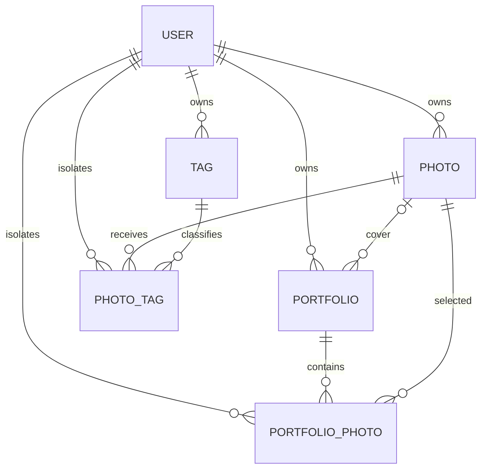

# AI Photography Archive - Stage 2-3 设计与实现说明

> 文档状态：已实现首版  
> 更新日期：2026-10-02  
> 前置基线：`docs/ai-photography-archive-stage-0-1.md`

---

## 1. 阶段目标

### Stage 2 - 数据库与照片存储

建立支持照片、标签和 Portfolio 的最小数据基础，并保证所有用户数据严格隔离。

阶段产物：

- 数据库关系设计；
- Flyway 版本化迁移；
- 照片存储目录和访问约定；
- 用户数据隔离规则；
- 删除与异常情况下的一致性规则。

### Stage 3 - 基础 Photography Library

实现一个不依赖 EXIF 和 AI、但真正可用的个人摄影图库。

阶段产物：

```text
登录 → 上传 JPEG/PNG → 生成缩略图 → Library
    → Photo Detail → 收藏 / 取消收藏 → 删除
```

---

## 2. 本阶段实现边界

### 已实现

- 保留现有 `user` 表；
- 新增 `photo`、`tag`、`photo_tag`、`portfolio`、`portfolio_photo`；
- 引入 Flyway 管理数据库版本；
- 照片原图和缩略图存储到文件系统；
- 数据库只保存 URL、storage key 和 metadata；
- JPEG/PNG 内容识别；
- 单文件 20MB 上限；
- 解码像素数上限；
- 最长边 1200px 的 JPEG 缩略图；
- 登录用户上传；
- 已登录路由通过 Umi `Outlet` 正确渲染，未登录访问返回登录页；
- 点击选择或拖拽上传；
- 多文件上传队列、真实发送进度和缩略图处理状态；
- 前端格式、空文件和 20MB 大小预检；
- 单文件失败隔离、错误原因和 Retry；
- 当前用户照片列表；
- Photo Detail；
- 收藏与取消收藏；
- 逻辑删除照片并清理文件；
- 原图和缩略图受登录及所有权保护；
- 两个用户之间的照片隔离集成测试；
- 黑白灰 Photography Archive 页面基础样式。

### 本阶段不实现

- EXIF 实际解析；
- GPS 地点解析；
- AI 图片理解；
- 标签写入；
- AI Create；
- Portfolio 创建业务；
- Story；
- Shooting Insights。

这些表和字段在 Stage 2 中建立，是为了避免后续反复重构数据库，但对应业务将在后续阶段实现。

---

## 3. 数据库策略

### 3.1 数据库环境

- 本地开发：H2 文件数据库，MySQL 兼容模式；
- 生产环境：MySQL；
- Schema 版本：Flyway；
- SQL 初始化：关闭 Spring `schema.sql` 自动初始化；
- 已存在的旧 `user` 表：Flyway 使用 baseline version 1 接管；
- 新数据库：依次执行 V1、V2、V3。

### 3.2 Flyway 迁移

```text
V1__create_user_table.sql
V2__create_photography_archive_tables.sql
V3__add_photography_archive_indexes.sql
```

规则：

1. 已执行的 migration 永远不直接修改。
2. 后续字段变更必须新增 migration。
3. 开发与生产执行同一组 migration。
4. 部署前必须备份数据库。
5. 不允许在生产环境手工修改表后不补 migration。

---

## 4. 数据库关系



所有摄影业务表都包含或关联当前用户。关联表额外保存 `user_id`，用少量冗余换取更明确的隔离条件和查询约束。

---

## 5. 表结构说明

## 5.1 `user`

沿用现有 User Center 用户表，不为摄影功能创建第二套账户系统。

关键字段：

- `id`：用户主键；
- `user_account`：登录账号；
- `user_password`：BCrypt 摘要；
- `user_status`：账户状态；
- `user_role`：普通用户或管理员；
- `is_delete`：逻辑删除。

本阶段同时强化登录校验：

- 每次读取当前用户时重新查询数据库；
- 已删除或停用用户的旧 Session 会失效；
- 管理员权限使用刷新后的角色，不继续信任登录时永久缓存的角色。

## 5.2 `photo`

`photo` 是摄影归档的核心表。

### 所有权与文件

| 字段 | 说明 |
| --- | --- |
| `id` | 照片主键 |
| `user_id` | 所属用户，不可为空 |
| `original_filename` | 上传时的原始文件名，仅用于显示 |
| `original_url` | 受保护的原图 API URL |
| `thumbnail_url` | 受保护的缩略图 API URL |
| `original_storage_key` | 原图在存储系统中的相对 key |
| `thumbnail_storage_key` | 缩略图在存储系统中的相对 key |
| `content_type` | 服务端识别的实际图片类型 |
| `file_size` | 原始文件字节数 |
| `width` / `height` | 图片像素尺寸 |
| `favorite` | 是否收藏 |

### EXIF 预留字段

- `camera_make`
- `camera_model`
- `lens_model`
- `focal_length`
- `aperture`
- `shutter_speed`
- `iso_value`
- `taken_at`

这些字段在 Stage 4 写入。

### GPS 和地点预留字段

- `gps_latitude`
- `gps_longitude`
- `location_name`

GPS 原始坐标保存在结构化数值字段中，地点解析结果单独保存，避免后续每次展示都重新调用地点服务。

### AI 预留字段

- `ai_description`
- `analysis_status`
- `analysis_error`

状态枚举约定：

- `PENDING`
- `ANALYZING`
- `COMPLETED`
- `FAILED`

Stage 3 上传后写入 `PENDING`，但暂不启动 AI 任务。

### 通用字段

- `create_time`
- `update_time`
- `is_delete`

照片删除采用逻辑删除，普通查询由 MyBatis-Plus 自动排除 `is_delete = 1` 的记录。

## 5.3 `tag`

用于保存可搜索的 AI 标签。

| 字段 | 说明 |
| --- | --- |
| `id` | 标签主键 |
| `user_id` | 标签所属用户 |
| `name` | 标签内容 |
| `tag_type` | scene、season、subject、color、general 等 |
| `create_time` | 创建时间 |

唯一约束：

```text
(user_id, tag_type, name)
```

标签按用户隔离。即使两个用户都有 `temple` 标签，也不会共享私人标签记录。

## 5.4 `photo_tag`

照片和标签的多对多关联。

| 字段 | 说明 |
| --- | --- |
| `user_id` | 冗余所有权字段 |
| `photo_id` | 照片 |
| `tag_id` | 标签 |
| `confidence` | AI 置信度，可空 |

唯一约束：

```text
(photo_id, tag_id)
```

应用层必须验证 photo、tag 和关联记录的 `user_id` 相同。

## 5.5 `portfolio`

保存已经创建的摄影作品集。

| 字段 | 说明 |
| --- | --- |
| `user_id` | 所属用户 |
| `title` | 标题 |
| `subtitle` | 副标题 |
| `cover_photo_id` | 封面照片，可空 |
| `is_delete` | 逻辑删除 |

V1 只有一种正式展示模式 Story，因此不保存模板类型。

## 5.6 `portfolio_photo`

保存 Portfolio 中的照片和顺序。

| 字段 | 说明 |
| --- | --- |
| `user_id` | 冗余所有权字段 |
| `portfolio_id` | Portfolio |
| `photo_id` | 照片 |
| `sort_order` | 从 0 或 1 开始的稳定顺序，由后续实现统一 |

约束：

- 同一个 Portfolio 中不能重复加入同一张照片；
- 同一个 Portfolio 中不能有重复顺序；
- 最多 20 张的规则由 Service 层强制执行；
- Portfolio 与 Photo 必须属于同一个用户。

---

## 6. 索引设计

当前索引覆盖主要查询路径：

- 用户名搜索；
- 当前用户按创建时间读取照片；
- 当前用户读取收藏照片；
- 当前用户读取照片标签；
- 当前用户按创建时间读取 Portfolio；
- 当前用户按顺序读取 Portfolio 照片。

核心索引：

```text
photo(user_id, is_delete, create_time)
photo(user_id, favorite, is_delete)
photo_tag(user_id, photo_id)
portfolio(user_id, is_delete, create_time)
portfolio_photo(user_id, portfolio_id, sort_order)
```

---

## 7. 照片存储约定

### 7.1 基本原则

- 图片二进制不写入 MySQL/H2；
- 数据库只保存 URL、storage key 和 metadata；
- 当前实现使用本地文件系统；
- 存储接口与业务 Service 分离，未来可替换为 S3、OSS 等对象存储；
- 存储目录不作为公开静态目录暴露；
- 原图和缩略图必须通过 PhotoController 做登录及所有权校验。

### 7.2 配置

本地默认：

```text
PHOTO_STORAGE_ROOT=./data/storage
```

从 `backend/` 目录启动时，对应：

```text
backend/data/storage/
```

生产环境必须配置绝对路径。

### 7.3 目录结构

```text
storage/
└── user-{userId}/
    ├── originals/
    │   └── {uuid}.{jpg|png}
    └── thumbnails/
        └── {uuid}.jpg
```

安全规则：

- 不使用用户上传文件名作为磁盘文件名；
- 使用 UUID 避免碰撞；
- storage key 解析后必须仍在 storage root 内；
- 禁止 `../` 路径穿越；
- 原始文件名只用于 UI 显示。

### 7.4 支持格式

Stage 3：

- JPEG；
- PNG。

服务端通过 ImageIO 读取实际图片格式，不相信浏览器提供的 MIME 或扩展名。

暂不支持：

- HEIC/HEIF；
- RAW；
- TIFF；
- WebP；
- GIF 动图；
- 视频。

### 7.5 上传限制

- 单文件最大 20MB；
- 最大解码像素数 80,000,000；
- 空文件拒绝；
- 无法解码的文件拒绝；
- 格式不支持时返回参数错误。

像素数限制用于降低超大压缩图片带来的内存风险。

### 7.6 缩略图

- 最长边最大 1200px；
- 不放大小图；
- 输出 JPEG；
- 质量约 0.86；
- 保持原始宽高比；
- 使用较高质量双三次插值。

Library 读取缩略图，Photo Detail 读取原图。

---

## 8. 文件访问规则

数据库保存的 URL：

```text
/api/photo/{photoId}/content?variant=thumbnail
/api/photo/{photoId}/content?variant=original
```

访问步骤：

1. 从 Session 获取当前用户；
2. 重新读取数据库用户状态；
3. 同时使用 `photo_id` 和 `user_id` 查询照片；
4. 查询不到统一返回照片不存在；
5. 从数据库取得 storage key；
6. 验证 key 位于 storage root；
7. 返回图片二进制。

这样不会因为用户猜到文件名、URL 或其他用户的 photo ID 而泄露照片。

---

## 9. 用户数据隔离规则

### 9.1 强制规则

所有照片查询必须包含当前用户条件：

```text
WHERE id = :photoId
  AND user_id = :currentUserId
  AND is_delete = 0
```

禁止使用以下模式：

```text
SELECT * FROM photo WHERE id = :photoId
```

然后再在 Controller 中比较 user ID。这种方式容易在后续代码中漏掉验证。

### 9.2 不接受前端提交 user_id

- 上传时的 `user_id` 只能来自服务端 Session；
- 列表查询的用户只能来自 Session；
- 收藏和删除的用户只能来自 Session；
- 前端请求体不得指定照片所属用户。

### 9.3 关联表规则

未来写入 PhotoTag 和 PortfolioPhoto 时，Service 必须确认：

```text
currentUserId == photo.userId
currentUserId == tag.userId
currentUserId == portfolio.userId
currentUserId == relation.userId
```

任何一个不一致都拒绝操作。

### 9.4 管理员规则

V1 Admin 不自动获得查看用户私人照片的权限。

管理员可以管理账号，但除非未来明确增加合规的审核功能，否则不能通过普通 Photo API 跨用户读取原图。

---

## 10. 写入与删除一致性

### 10.1 上传流程

```text
校验 Session
  → 校验大小和真实格式
  → 检查像素尺寸
  → 写临时原图
  → 原子移动原图
  → 生成并原子移动缩略图
  → 写入 photo 数据库记录
  → 更新受保护的内容 URL
  → 返回 PhotoVO
```

如果数据库写入失败，删除已经创建的原图和缩略图。

文件使用临时文件和原子移动，避免把未写完的文件暴露为有效照片。

### 10.2 删除流程

```text
校验 Session
  → 按 id + user_id 查询
  → 数据库逻辑删除
  → 删除原图
  → 删除缩略图
```

数据库删除优先。如果磁盘清理失败，业务记录仍不可见，残留文件可由未来的清理任务回收。

### 10.3 后续改进

当存储切换为对象存储或业务规模扩大后，可增加：

- outbox / cleanup task；
- 定时孤儿文件清理；
- 文件 hash 去重；
- 病毒与恶意文件扫描；
- 对象存储生命周期策略。

这些不是当前 V1 必需项。

---

## 11. 后端模块结构

```text
controller/
├── PhotoController
└── UserController

service/
├── LoginUserService
├── PhotoService
└── impl/PhotoServiceImpl

storage/
├── PhotoStorageService
├── LocalPhotoStorageService
└── StoredPhoto

mapper/
├── PhotoMapper
├── TagMapper
├── PhotoTagMapper
├── PortfolioMapper
└── PortfolioPhotoMapper

model/
├── entity/
│   ├── Photo
│   ├── Tag
│   ├── PhotoTag
│   ├── Portfolio
│   └── PortfolioPhoto
├── dto/photo/PhotoFavoriteRequest
└── vo/PhotoVO
```

---

## 12. Photography Library API

| 功能 | 方法与路径 | 权限 |
| --- | --- | --- |
| 上传 | `POST /api/photo/upload` | 已登录 |
| 列表 | `GET /api/photo` | 已登录，仅本人 |
| 收藏列表 | `GET /api/photo?favorite=true` | 已登录，仅本人 |
| 详情 | `GET /api/photo/{id}` | 已登录，仅本人 |
| 缩略图 | `GET /api/photo/{id}/content?variant=thumbnail` | 已登录，仅本人 |
| 原图 | `GET /api/photo/{id}/content?variant=original` | 已登录，仅本人 |
| 收藏 | `PATCH /api/photo/{id}/favorite` | 已登录，仅本人 |
| 删除 | `DELETE /api/photo/{id}` | 已登录，仅本人 |

### 上传请求

```text
Content-Type: multipart/form-data
field name: file
```

### 收藏请求

```json
{
  "favorite": true
}
```

---

## 13. 前端页面实现

### 13.1 Library

已实现：

- 登录后 `/` 重定向到 `/library`；
- 未登录访问受保护页面会跳转登录，登录后返回原目标页面；
- 大标题和 Photography Archive 导航；
- JPEG/PNG 点击选择或拖拽多选上传；
- 上传前格式、空文件和 20MB 大小检查；
- 每个文件独立显示 Waiting、Uploading、Processing thumbnail、Completed、Failed；
- 使用浏览器真实上传字节进度，不展示伪造百分比；
- 单张失败不阻塞其他文件，并支持 Retry；
- All / Favorites 切换；
- 文件名、地点或相机的当前结果本地过滤；
- Masonry 照片网格；
- 缩略图；
- 收藏与取消收藏；
- 分析状态；
- 空状态和加载状态；
- 接口失败状态和 Retry；
- 点击照片进入详情。

### 13.2 Photo Detail

已实现：

- 大图展示；
- 文件名；
- 图片尺寸；
- 文件大小；
- 实际图片类型；
- 上传时间；
- 收藏与取消收藏；
- 删除确认；
- EXIF、地点和 AI 区域预留。

### 13.3 未完成阶段入口

导航保留：

- AI Create；
- Portfolios；
- Insights；
- Profile。

未到开发阶段的页面只显示明确的阶段说明，不伪装成已经完成的功能。

---

## 14. UI 应用情况

Stage 3 已开始应用 Stage 1 确认的设计系统：

- 深灰主背景；
- 黑白灰界面色；
- 图片保留原色；
- Inter / Noto Sans SC 字体栈；
- 柔和中大圆角；
- 大标题、大留白；
- 低对比边框；
- 深色半透明照片信息层；
- 克制的 Hover 动效；
- 响应式两列/单列布局。

Stage 9 仍负责最终像素级精修。

---

## 15. 验证与测试

### 后端集成测试

`PhotoControllerIntegrationTest` 覆盖：

1. 创建两个不同用户；
2. 第一个用户上传 PNG；
3. 服务端生成缩略图；
4. 当前用户列表返回照片；
5. 缩略图可读取且为 JPEG；
6. 第二个用户不能读取第一个用户的照片；
7. 收藏状态更新；
8. 删除照片；
9. 删除后列表为空。

### 构建验证

```bash
cd backend
mvn test

cd ../frontend
pnpm build
```

### 手工验收流程

1. 注册并登录；
2. 打开 Library；
3. 确认可以看到工具栏 Upload photos 和空图库上传入口；
4. 分别通过文件选择器和拖拽上传 JPEG、PNG；
5. 确认上传队列显示发送、缩略图处理、完成或失败状态；
6. 验证不支持的格式、空文件和超过 20MB 的文件被拒绝；
7. 验证缩略图和比例；
8. 刷新页面，确认照片仍存在；
9. 收藏照片并切换 Favorites；
10. 打开 Photo Detail；
11. 查看原图和文件信息；
12. 删除照片；
13. 确认 Library 不再显示照片；
14. 使用另一个用户确认无法访问前一个用户的照片 URL。

---

## 16. 当前限制

- 本地文件系统适合单机开发，不适合无共享磁盘的多实例部署；
- 当前列表一次返回全部照片，照片量增大后需要服务端分页；
- JPEG 方向校正依赖后续 EXIF 阶段；
- PNG 透明区域生成 JPEG 缩略图时使用 RGB 背景；
- 暂不支持 HEIC 和 RAW；
- 删除后的磁盘清理失败只做容错，不会立即重试；
- 业务错误仍沿用项目现状，以 HTTP 200 + 业务 code 返回；
- AI 状态当前写入 PENDING，但不会启动分析任务。

---

## 17. Stage 2-3 完成标准

满足以下条件可认为 Stage 2-3 首版完成：

- 数据库可以由 Flyway 创建或升级；
- 五张摄影业务表存在；
- 照片文件不进入数据库；
- 原图与缩略图目录按用户隔离；
- 所有 Photo API 使用 Session 用户并限定 `user_id`；
- JPEG/PNG 可以上传；
- 空图库和工具栏都有清晰的上传入口；
- 多文件上传具有逐文件状态、失败隔离和重试；
- 登录后的受保护路由能够正常渲染而不是空白；
- Library 可以显示当前用户照片；
- Photo Detail 可以查看原图与基础信息；
- 收藏可切换；
- 删除后照片不再出现在列表中；
- 其他用户无法访问照片记录和二进制内容；
- 后端集成测试通过；
- 前端生产构建通过。

下一阶段 Stage 4 将在此基础上读取 EXIF、处理拍摄方向、补充摄影参数并解析 GPS 地点。
